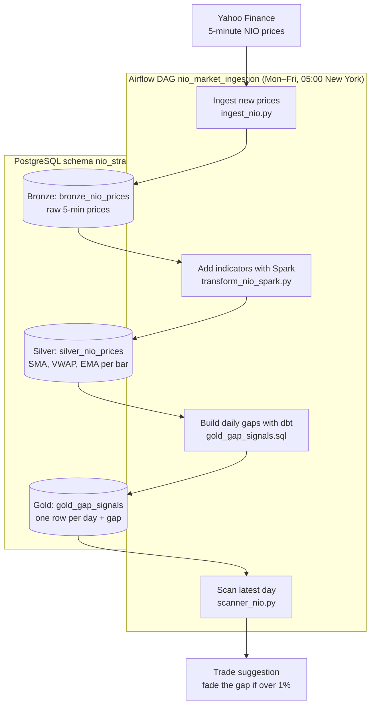

# 📈 NIO Gap Reversion Engine

[](https://github.com/AAliasghar/nio-gap-reversion-engine/actions/workflows/ci.yml)
[](LICENSE)

A data pipeline that studies **opening gaps** in NIO stock: how far the pre-market open jumps away from the previous close, and whether the price comes back to "fill" the gap during the regular session.

It runs end to end in Docker: **Airflow** schedules the jobs, **yfinance** supplies 5-minute prices, **PySpark** builds the features, **dbt** builds the daily gap table in **PostgreSQL**, and a scanner prints the latest gap signal.

> **Status:** research / learning project. The pipeline produces gap features and a gap-fill label for each day, and a [backtest](#-backtest-results) measures how often gaps fill and what the scanner's fade rule would have earned (before costs, it loses slightly). Nothing here is trading advice.

---

## 🧠 Strategy idea

Large opening gaps are often overreactions, and the price frequently moves back toward the previous close. The pipeline measures this for every trading day:

- **Gap** = pre-market open − previous regular-session close (value and %)
- **Trend context** = previous close vs. the 20-day SMA
- **Gap filled?** = did the regular session (09:30–16:00 New York) trade back through the previous close (`gap_filled_flag`)

The scanner then applies a simple rule to the latest day: if the gap is larger than **1%**, it suggests fading it (gap up → short, gap down → long); otherwise no trade.

---

## 🏗 Architecture (medallion layers)

```
Airflow DAG "nio_market_ingestion" (Mon–Fri, 05:00 New York)

fetch_and_load_nio        yfinance 5-min OHLCV (incl. pre/post market)
        │                 → nio_strategy.bronze_nio_prices         (Bronze)
        ▼
pyspark_silver_transform  20-bar SMA, volume MA, VWAP, EMA-20, daily cumulative volume
        │                 → nio_strategy.silver_nio_prices         (Silver)
        ▼
dbt_run_models            daily gap, 20-day SMA / volume MA / VWAP MA, trend, gap_filled_flag
        │                 → nio_strategy.gold_gap_signals          (Gold)
        ▼
analyze_gap_signals       reads the latest gold row and prints the signal
```

### Flowchart

Each Airflow task writes a table, and the next task reads it:




---

## 📂 Project structure

```
nio-gap-reversion-engine/
├── dags/
│   └── nio_dag.py                 # Airflow DAG: ingest → Spark → dbt → scanner
├── scripts/
│   ├── config.py                  # DB settings from NIO_DB_* env vars
│   ├── ingest_nio.py              # yfinance → bronze table (incremental)
│   ├── transform_nio_spark.py     # PySpark bronze → silver features
│   └── scanner_nio.py             # reads gold table, prints the signal
├── sql/
│   ├── Nio_Trading.sql            # exploratory SQL
│   └── nio_strategies/            # dbt project
│       ├── models/gold_gap_signals.sql
│       ├── models/source.yml
│       ├── dbt_project.yml
│       └── profiles.yml           # connection from env vars
├── backtest/
│   ├── gap_backtest.py            # gap-fill rates + fade-rule backtest
│   ├── data/nio_1h.csv            # saved hourly bars (with pre-market)
│   └── results/                   # tables shown in this README
├── tests/                         # pytest (config, project layout, backtest)
├── .github/workflows/ci.yml       # CI: compose check + tests
├── docker-compose.yml             # Postgres warehouse, Airflow + its DB
├── Dockerfile                     # Airflow 2.7 + Java 11 + PySpark + dbt
├── .env.example
└── LICENSE
```

---

## 🚀 Getting started

**Requirements:** Docker with Docker Compose.

```bash
git clone https://github.com/AAliasghar/nio-gap-reversion-engine.git
cd nio-gap-reversion-engine

cp .env.example .env        # then change the passwords in .env
docker compose up --build
```

- Airflow UI: http://localhost:8080 (user `admin`, password from `AIRFLOW_ADMIN_PASSWORD`)
- Warehouse: PostgreSQL on `localhost:5432`, database `trading_warehouse`, schema `nio_strategy`

In the Airflow UI, unpause and trigger the **`nio_market_ingestion`** DAG. The first run loads the last 60 days of 5-minute data (the yfinance limit for this interval); later runs load only new bars. If the DAG has not run for more than 60 days, the next run loads the last 59 days and logs a warning about the missing days; the gold model does not compute a gap across such a hole.

**Tested end to end** on 2026-11-02 in Docker: all four tasks (ingest → PySpark → dbt → scanner) succeeded, loading 22,826 five-minute bars into bronze and silver and 123 trading days into `gold_gap_signals`.

### Configuration

All connection settings come from environment variables (see `.env.example`):

| Variable | Used by | Notes |
|---|---|---|
| `NIO_DB_HOST`, `NIO_DB_PORT` | scripts, dbt | Inside Docker these are set to `nio_postgres:5432` by `docker-compose.yml` |
| `NIO_DB_NAME`, `NIO_DB_USER`, `NIO_DB_PASSWORD` | Postgres, scripts, dbt | Shared by the warehouse container and the pipeline |
| `AIRFLOW_ADMIN_PASSWORD`, `AIRFLOW_SECRET_KEY` | Airflow | Change both outside local testing |

### Running dbt by hand

```bash
docker compose exec airflow bash -c "cd /opt/airflow/sql/nio_strategies && dbt run --profiles-dir ."
```

---

## 📊 Output: `nio_strategy.gold_gap_signals`

One row per trading day:

| Column | Meaning |
|---|---|
| `trading_date` | New York trading date |
| `pre_market_open`, `prev_regular_close` | First pre-market price, previous day's 16:00 close |
| `gap_value`, `gap_percentage` | Size of the opening gap |
| `sma_20_daily`, `is_above_ma_20`, `daily_trend` | Trend context from the 20-day SMA |
| `gap_filled_flag` | 1 if the regular session traded back to the previous close |
| `prev_daily_vol_ma_20`, `prev_daily_vwap_20` | 20-day volume and VWAP averages |

---

## 📉 Backtest results

`backtest/gap_backtest.py` applies the same definitions as `gold_gap_signals` to **729 trading days** of hourly NIO bars with pre-market trading (2023-12-05 to 2026-10-30, the most Yahoo offers at this interval). The 5-minute data the pipeline uses only goes back 60 days, too short for a backtest. The bars are saved in `backtest/data/nio_1h.csv`, so the numbers below can be reproduced exactly.

**How often gaps fill** (701 days with a gap; 58.9% filled):

| Gap size | Up gaps: days | Up gaps: filled | Down gaps: days | Down gaps: filled |
|---|--:|--:|--:|--:|
| < 1% | 163 | 82.8% | 136 | 60.3% |
| 1–2% | 107 | 72.0% | 89 | 38.2% |
| 2–4% | 110 | 48.2% | 46 | 34.8% |
| ≥ 4% | 33 | 30.3% | 17 | 35.3% |

Up gaps fill much more often than down gaps, and the bigger the gap, the less likely it fills. Trend changes this less: up gaps filled 70% of the time in a downtrend vs 64% in an uptrend; down gaps 51% vs 41%. Full table by trend: `backtest/results/fill_rates.csv`.

**The scanner's fade rule** (gap > 1% → trade against it from the 09:30 open; exit at the previous close if reached, otherwise at the 16:00 close):

| Trades | Count | Win rate | Avg win | Avg loss | Avg per trade | Worst trade |
|---|--:|--:|--:|--:|--:|--:|
| Short (fading up gaps) | 215 | 63.7% | +1.76% | −2.83% | **+0.09%** | −9.86% |
| Long (fading down gaps) | 147 | 48.3% | +1.92% | −2.47% | **−0.35%** | −6.35% |
| All | 362 | 57.5% | +1.81% | −2.66% | **−0.09%** | −9.86% |

The rule wins more often than it loses, but its losses are bigger than its wins, so **it loses money on average before any costs**. Fading up gaps is roughly break-even; fading down gaps loses. After commissions, slippage and short-borrow fees, both would be worse.

Read with care: one stock, under three years, no stop-loss, no costs, and a trade is skipped when the 09:30 open has already closed the gap (so no pre-market trading). Every trade: `backtest/results/trades.csv`.

```bash
python backtest/gap_backtest.py             # recompute from the saved bars
python backtest/gap_backtest.py --refresh   # download the latest 730 days first (numbers will change)
```

---

## 🧪 Tests

```bash
pip install -r requirements-dev.txt
pytest -v
docker compose config -q
```

The tests check the config module and that each key file holds what its path promises (compose stack, dbt profile, Airflow DAG, Spark job), so a file written to the wrong path fails CI instead of breaking `main`. The backtest tests run its calculations on small made-up price bars (gap and fill detection, trade entries and exits). CI runs them on pushes to `main` and on pull requests into `main`.

---

## 🎯 Roadmap

- [x] Backtest the gap-fade rule: gap-fill rate by gap size and trend, win rate, average win/loss
- [ ] Test variations of the rule: only fade up gaps, a stop-loss, costs and slippage
- [ ] Volume confirmation in the gold model (pre-market volume vs. 20-day average)
- [ ] dbt tests (not-null, unique `trading_date`, accepted values)
- [ ] Multi-symbol support (beyond NIO)
- [ ] Dashboard for the daily signals

---

## ⚠️ Disclaimer

**This is a research/educational project, not financial advice.** Trading involves substantial risk of loss. The backtest above is limited (one stock, under three years, no costs) and shows the rule losing money on average; nothing here has been tested in live trading.

---

## 📝 License

MIT. See [LICENSE](LICENSE).

---

## 📧 Contact

**Author:** Aliasghar Asgharinia ([@AAliasghar](https://github.com/AAliasghar)) · [Open an issue](https://github.com/AAliasghar/nio-gap-reversion-engine/issues)
