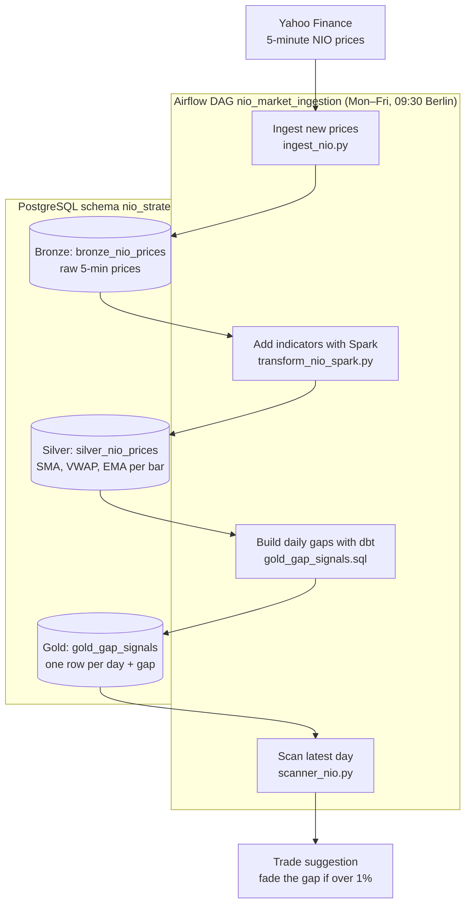

# 📈 NIO Gap Reversion Engine

[](https://github.com/AAliasghar/nio-gap-reversion-engine/actions/workflows/ci.yml)
[](LICENSE)

A data pipeline that studies **opening gaps** in NIO stock: how far the pre-market open jumps away from the previous close, and whether the price comes back to "fill" the gap during the regular session.

It runs end to end in Docker: **Airflow** schedules the jobs, **yfinance** supplies 5-minute prices, **PySpark** builds the features, **dbt** builds the daily gap table in **PostgreSQL**, and a scanner prints the latest gap signal.

> **Status:** research / learning project. The pipeline produces gap features and a gap-fill label for each day; there is no backtest or performance figure yet (see [Roadmap](#-roadmap)). Nothing here is trading advice.

---

## 🧠 Strategy idea

Large opening gaps are often overreactions, and the price frequently moves back toward the previous close. The pipeline measures this for every trading day:

- **Gap** = pre-market open − previous regular-session close (value and %)
- **Trend context** = previous close vs. the 20-day SMA
- **Gap filled?** = did the regular session (09:30–16:00 New York) trade back through the previous close (`gap_filled_flag`)

The scanner then applies a simple rule to the latest day: if the gap is larger than **1%**, it suggests fading it (gap up → short, gap down → long); otherwise no trade.

---

## 🏗 Architecture (medallion layers)

```
Airflow DAG "nio_market_ingestion" (Mon–Fri, 09:30 Europe/Berlin)

fetch_and_load_nio        yfinance 5-min OHLCV (incl. pre/post market)
        │                 → nio_strategy.bronze_nio_prices         (Bronze)
        ▼
pyspark_silver_transform  20-bar SMA, volume MA, VWAP, EMA-20, daily cumulative volume
        │                 → nio_strategy.silver_nio_prices         (Silver)
        ▼
dbt_run_models            daily gap, 20-day SMA / volume MA / VWAP MA, trend, gap_filled_flag
        │                 → nio_strategy.gold_gap_signals          (Gold)
        ▼
analyze_gap_signals       reads the latest gold row and prints the signal
```

### Flowchart

Each Airflow task writes a table, and the next task reads it:




---

## 📂 Project structure

```
nio-gap-reversion-engine/
├── dags/
│   └── nio_dag.py                 # Airflow DAG: ingest → Spark → dbt → scanner
├── scripts/
│   ├── config.py                  # DB settings from NIO_DB_* env vars
│   ├── ingest_nio.py              # yfinance → bronze table (incremental)
│   ├── transform_nio_spark.py     # PySpark bronze → silver features
│   └── scanner_nio.py             # reads gold table, prints the signal
├── sql/
│   ├── Nio_Trading.sql            # exploratory SQL
│   └── nio_strategies/            # dbt project
│       ├── models/gold_gap_signals.sql
│       ├── models/source.yml
│       ├── dbt_project.yml
│       └── profiles.yml           # connection from env vars
├── tests/                         # pytest (config + project layout checks)
├── .github/workflows/ci.yml       # CI: compose check + tests
├── docker-compose.yml             # Postgres warehouse, Airflow + its DB
├── Dockerfile                     # Airflow 2.7 + Java 11 + PySpark + dbt
├── .env.example
└── LICENSE
```

---

## 🚀 Getting started

**Requirements:** Docker with Docker Compose.

```bash
git clone https://github.com/AAliasghar/nio-gap-reversion-engine.git
cd nio-gap-reversion-engine

cp .env.example .env        # then change the passwords in .env
docker compose up --build
```

- Airflow UI: http://localhost:8080 (user `admin`, password from `AIRFLOW_ADMIN_PASSWORD`)
- Warehouse: PostgreSQL on `localhost:5432`, database `trading_warehouse`, schema `nio_strategy`

In the Airflow UI, unpause and trigger the **`nio_market_ingestion`** DAG. The first run loads the last 60 days of 5-minute data (the yfinance limit for this interval); later runs load only new bars.

### Configuration

All connection settings come from environment variables (see `.env.example`):

| Variable | Used by | Notes |
|---|---|---|
| `NIO_DB_HOST`, `NIO_DB_PORT` | scripts, dbt | Inside Docker these are set to `nio_postgres:5432` by `docker-compose.yml` |
| `NIO_DB_NAME`, `NIO_DB_USER`, `NIO_DB_PASSWORD` | Postgres, scripts, dbt | Shared by the warehouse container and the pipeline |
| `AIRFLOW_ADMIN_PASSWORD`, `AIRFLOW_SECRET_KEY` | Airflow | Change both outside local testing |

### Running dbt by hand

```bash
docker compose exec airflow bash -c "cd /opt/airflow/sql/nio_strategies && dbt run --profiles-dir ."
```

---

## 📊 Output: `nio_strategy.gold_gap_signals`

One row per trading day:

| Column | Meaning |
|---|---|
| `trading_date` | New York trading date |
| `pre_market_open`, `prev_regular_close` | First pre-market price, previous day's 16:00 close |
| `gap_value`, `gap_percentage` | Size of the opening gap |
| `sma_20_daily`, `is_above_ma_20`, `daily_trend` | Trend context from the 20-day SMA |
| `gap_filled_flag` | 1 if the regular session traded back to the previous close |
| `prev_daily_vol_ma_20`, `prev_daily_vwap_20` | 20-day volume and VWAP averages |

---

## 🧪 Tests

```bash
pip install -r requirements-dev.txt
pytest -v
docker compose config -q
```

The tests check the config module and that each key file holds what its path promises (compose stack, dbt profile, Airflow DAG, Spark job), so a file written to the wrong path fails CI instead of breaking `main`. CI runs them on every push and pull request.

---

## 🎯 Roadmap

- [ ] Backtest the gap-fade rule on the gold table: gap-fill rate by gap size and trend, win rate, profit factor, max drawdown
- [ ] Volume confirmation in the gold model (pre-market volume vs. 20-day average)
- [ ] dbt tests (not-null, unique `trading_date`, accepted values)
- [ ] Multi-symbol support (beyond NIO)
- [ ] Dashboard for the daily signals

---

## ⚠️ Disclaimer

**This is a research/educational project, not financial advice.** Trading involves substantial risk of loss, and nothing in this repository has been validated with a backtest or live trading.

---

## 📝 License

MIT. See [LICENSE](LICENSE).

---

## 📧 Contact

**Author:** [AAliasghar](https://github.com/AAliasghar) · [Open an issue](https://github.com/AAliasghar/nio-gap-reversion-engine/issues)
